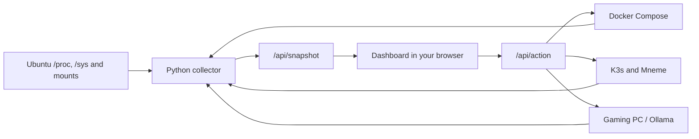

# Mount Olympus

Mount Olympus is the homelab control room. It runs beside Mneme on Ubuntu. The Python server listens on loopback and has its own login. Tailscale Serve can give it a private HTTPS address for computers and phones on your tailnet.

## Open it on iPhone

1. Install [Tailscale for iOS](https://tailscale.com/docs/install/ios), sign in to the same tailnet as Ubuntu, and connect.
2. Open the dashboard's HTTPS address in Safari and sign in. The site works in Safari as-is.
3. To pin it, tap **Share → Add to Home Screen**, leave **Open as Web App** enabled, then tap **Add**. The Home Screen icon opens the same dashboard in its own window. It needs a connection to Ubuntu to display current readings and run actions.

The browser reads `manifest.webmanifest` for the app name and standalone display mode; iOS uses `apple-touch-icon.png` for the icon. The web app uses the same live API as Safari.

## Open the live dashboard

Start the tunnel if it isn't already running. Leave this terminal open while you use it.

```sh
ssh -N -o ExitOnForwardFailure=yes -L 127.0.0.1:8790:127.0.0.1:8790 sunny@100.75.237.37
```

Open [Mount Olympus](http://127.0.0.1:8790/). On a new install, sign in as `homelab` and retrieve the initial password privately in your terminal.

```sh
ssh sunny@100.75.237.37 'cat ~/.config/homelab-dashboard/password'
```

### Choose your dashboard login

Run this from your Mac. Enter the username and password you want at the prompts. The password is hidden as you type; use a passphrase or generated password of at least 16 characters. This login is independent of SSH and Pi-hole.

```sh
ssh -t sunny@100.75.237.37 'python3 ~/.local/share/homelab-dashboard/login.py && systemctl --user restart homelab-dashboard'
```

### Configure private HTTPS

On Ubuntu, put the dashboard's Tailscale DNS name in the service configuration. This assumes port 443 on the tailnet host is available; check `tailscale serve status` before using it.

```sh
umask 077
tailscale status --json | python3 -c 'import json,sys; print(json.load(sys.stdin)["Self"]["DNSName"].rstrip("."))' > ~/.config/homelab-dashboard/https-host
systemctl --user restart homelab-dashboard
sudo tailscale serve --bg --https=443 http://127.0.0.1:8790
tailscale serve status
```

Open the HTTPS address printed by Serve. It handles TLS, then passes the request to the loopback server. The dashboard checks the configured hostname, the login, and the page origin on action requests. It rejects requests identified as Tailscale Funnel traffic. To remove this route, run `sudo tailscale serve --https=443 off`.

## Follow one measurement

1. Open **Overview** and locate **Memory in use**.
2. Open your browser's developer tools and select **Network**. Click the dashboard refresh button, select `/api/snapshot` and inspect its JSON response.
3. Find `host.memory` and `host.memory_total` in the response. Both numbers are bytes. In [collect.py](collect.py), `Collector.host` computes memory in use as Linux's `MemTotal - MemAvailable`.
4. Find `renderHost` in [dashboard.js](dashboard.js). It formats those same bytes into GiB for the card and passes the raw values to the progress bar.
5. On Ubuntu, run `free -h` to compare your dashboard with the OS. The numbers can shift between samples.



A short runtime sample runs every eight seconds. A separate scan runs every five minutes and measures allocated bytes in the configured data directories. A dash means a value is missing or unavailable. **Partial** means the service total includes only the paths measured so far. A workload's CPU percentage is relative to one logical CPU, so it can exceed 100% when it uses multiple cores. The overview CPU card uses the entire host as its denominator.

### Try a change in the example dashboard

From the repository root on your Mac, run this and open [the example dashboard](http://127.0.0.1:8791/).

```sh
PYTHONPATH=. python3 dashboard/server.py --demo --port 8791
```

Click **Stop** for Jellyfin, confirm, then open the `/api/action` request in DevTools. Its body contains `id: jellyfin`, `action: stop`, and the expected state. The example backend changes its in-memory state. The live backend checks the real state and runs the named Compose project's `stop` command. K3s controls use a replica-count precondition and set Mneme to zero or one replicas. Persistent app data stays on disk. Mneme's temporary imports are removed when its pod stops.

Try changing a number in [demo.py](demo.py), restart the example server and refresh the page. You can also open **GPU Worker**, send a coding prompt and try copying the example code. The demo uses simulated power and model responses.

## Install or update on Ubuntu

From the repository root on the Mac, copy the dashboard files and the shared Ollama client to a temporary directory over SSH.

```sh
set -o pipefail
COPYFILE_DISABLE=1 tar --format=ustar -cf - wake.py \
  dashboard/{server.py,login.py,collect.py,worker.py,demo.py,admin.py,index.html,dashboard.css,dashboard.js,manifest.webmanifest,icon.svg,apple-touch-icon.png,install.sh,enable-admin.sh} |
  ssh sunny@100.75.237.37 'set -eu; tmp=$(mktemp -d); trap "rm -rf -- \"$tmp\"" EXIT; tar -xf - -C "$tmp"; bash "$tmp/dashboard/install.sh"'
```

The installer uses the logged-in user's existing Docker permissions. It puts the dashboard in `~/.local/share/homelab-dashboard`, preserves its login across updates and restarts its user service. Its configuration stays in `~/.config/homelab-dashboard`, outside Git. Inspect the service on Ubuntu with `systemctl --user status homelab-dashboard` and `journalctl --user -u homelab-dashboard -n 30`.

### Enable the Mneme bridge

Run this once. Enter the Ubuntu sudo password in your terminal.

```sh
ssh -t sunny@100.75.237.37 'sudo bash ~/.local/share/homelab-dashboard/enable-admin.sh'
```

[enable-admin.sh](enable-admin.sh) installs the root-owned [admin.py](admin.py) with four permitted commands. They read Mneme deployment and worker settings, measure storage, or scale the exact Mneme deployment to one or zero replicas. The helper measures protected Immich volumes too. The install also enables the dashboard user service at boot via systemd lingering. Refresh the dashboard after the next sample. Protected storage updates on the next directory scan.

The current Compose and storage mappings in [collect.py](collect.py) reflect your Ubuntu host. Update those mappings if you move a library or Compose project. If you change the privileged helper, review it and rerun the bridge installer to update the root-owned copy.

## Ollama and the gaming PC

- The dashboard prefers the Mneme worker configuration from K3s. When that is unavailable, it reads `~/.config/homelab-dashboard/worker.json` on Ubuntu. Passive polling checks installed and loaded models. Model size is the configured model's reported size. Loaded VRAM is Ollama's per-model value, reported through `GET /api/ps`.
- **Power on** uses the configured Ethernet MAC and LAN broadcast address, then waits for Ollama. With the Windows gateway, it requests a managed session where available. **Shut down** asks the Windows gateway to shut down after you confirm. The gateway requires shutdown to be enabled and nobody to be signed in. Automatic shutdown still uses the managed session. An unreachable endpoint can mean the PC is off or the worker is unavailable.
- **Chat** uses the existing configured model. It sends only the supplied prompt and recent turns, keeps the conversation in the browser tab and unloads the model after the response. Generated code is displayed for you to read or copy. The chat does not have filesystem or shell tools.
- For dual boot, use a dedicated Linux SSD if available, save the Windows recovery key, choose a distro and kernel supported for your AMD card, then verify GPU offload and full-shutdown Wake-on-LAN. Linux as the default boot target suits unattended inference. Switching Windows and Linux requires a reboot. See the [AMD compatibility matrix](https://rocm.docs.amd.com/projects/radeon-ryzen/en/latest/docs/compatibility/compatibilityrad/native_linux/native_linux_compatibility.html) and [Windows Wake-on-LAN behavior](https://learn.microsoft.com/en-us/troubleshoot/windows-client/deployment/wake-on-lan-feature).
- For remote desktop and gaming, install Sunshine on Windows, pair Moonlight on the Mac on your LAN, then verify a private Tailscale connection with a Windows tailnet address. Use Moonlight's Desktop entry for ordinary Windows apps. See [Sunshine setup](https://docs.lizardbyte.dev/projects/sunshine/latest/md_docs_2getting__started.html) and [Moonlight setup](https://github.com/moonlight-stream/moonlight-docs/wiki/Setup-Guide).

## Raspberry Pi and Pi-hole

Pi-hole runs on the Pi's wired address, currently `192.168.1.166`, with Quad9 as its upstream resolver. Its [admin page](http://192.168.1.166/admin/) is available from the home LAN. Set your own admin password in Terminal.

```sh
ssh -t -o HostKeyAlias=192.168.1.239 pi5homeserver@192.168.1.166 'sudo pihole setpassword'
```

From the Mac, send a normal lookup and a test ad lookup directly to the Pi. The ad domain should return `0.0.0.0`.

```sh
dig @192.168.1.166 example.com A
dig @192.168.1.166 doubleclick.net A
```

The router reserves the Pi's wired address and forwards DNS to it. The Overview card checks DNS resolution and the admin page from Ubuntu about once a minute. Its DNS time comes from `dig` in the Ubuntu `dnsutils` package.
